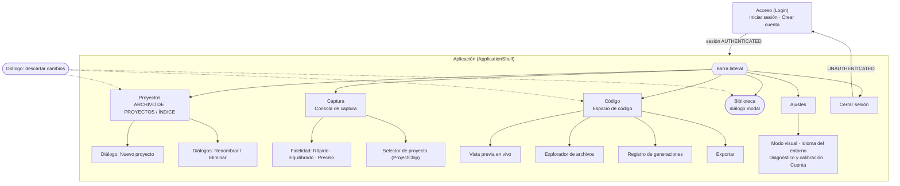
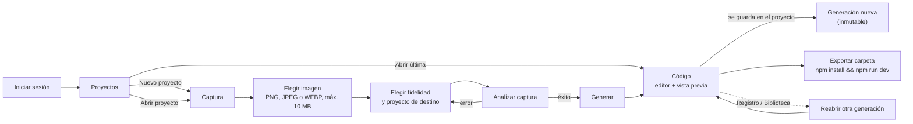
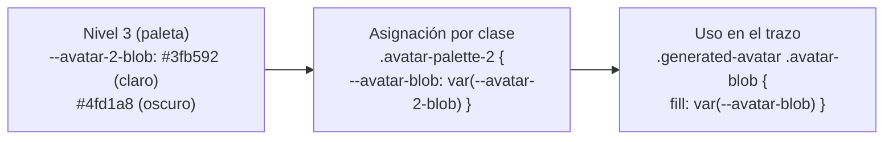

# Vision2Code: Arquitectura de Información y Design System

Documento del taller de Arquitectura de Información y Design Systems. Describe **lo que existe hoy en el repositorio** (rama `docs/ia-design-system`, basada en `main`); cada pantalla, componente y token citado se verificó con búsqueda en el código. Cuando el documento y el código discrepan, manda el código (ver `docs/engineering-rules.md`).

## 1. Introducción

Vision2Code es una aplicación de escritorio (Tauri 2 + React 19) que convierte una captura de una interfaz en código React + Tailwind.

- El usuario sube una imagen, elige un nivel de fidelidad y el servidor la analiza con un modelo de IA.
- Del análisis sale un esquema (UISchema) y de este, de forma determinista, un proyecto React que se edita en Monaco y se ve en una vista previa aislada.
- El resultado se guarda en la nube por **Proyecto** (cada guardado es una **Generación** inmutable) y se puede exportar como carpeta ejecutable.
- Sirve a diseñadores y desarrolladores front-end que quieren un punto de partida de código a partir de un diseño ya hecho, y a quienes deben volver a trabajos anteriores.
- Requiere iniciar sesión; las capturas nunca se guardan, solo el artefacto generado.

## 2. Arquitectura de Información

### 2.1 Sistema de organización

#### Mapa del sitio

La navegación real vive en `ApplicationShell.tsx` (`view`: `projects | capture | editor | settings`) más el diálogo de Biblioteca montado en `App.tsx`. Con servicios de usuario la vista inicial es **Proyectos**; sin ellos, **Captura**.

Notas verificadas:
- La marca "V" de la barra lateral lleva a Captura (`brand-mark`).
- Todos los diálogos son modales (`role="dialog"`, `aria-modal`) con el foco atrapado: `DiscardDialog`, `LibraryDialog`, `NewProjectDialog` y `ProjectManageDialog`.
- Un enlace "Saltar al espacio de trabajo" (`skip-link`) apunta al `main` de la vista actual.
- Los estados de autenticación que el Login distingue son `RESTORING`, `UNAUTHENTICATED`, `AUTHENTICATING`, `AWAITING_EMAIL_CONFIRMATION`, `AUTHENTICATED` y `SIGNING_OUT`. El shell se desmonta al cerrar sesión (no se oculta).

#### Modelo de jerarquía

La aplicación combina **tres** modelos, cada uno donde encaja:

| Modelo | Dónde se usa | Ejemplo real | Por qué |
| --- | --- | --- | --- |
| **Secuencial** | Captura → Código | La tira `workflow-strip` (`<ol>`) muestra 5 etapas: Entrada, Perfil, Análisis, Resultado, Exportación; `aria-current="step"` marca la actual. Al pulsar "Generar", la app salta a Código. | Es un proceso con orden obligatorio: sin imagen no hay análisis, sin análisis no hay código. La tira solo informa; no es clicable. |
| **Facetado** | Proyectos | Búsqueda por texto + filtro **Estado** (Todos / Activo / Borrador) + **Ordenar** (Recientes / Nombre / Generaciones), combinables (`visibleProjects` en `vaultSelectors.ts`). | El usuario recupera trabajo previo por varios atributos a la vez. Se muestra el recuento resultante ("N proyectos encontrados", "N generaciones"). |
| **Jerárquico** | Biblioteca, Registro de generaciones | Proyecto → Generaciones: en el diálogo de Biblioteca cada proyecto es un botón desplegable (`aria-expanded`) que revela sus generaciones, numeradas y con su fidelidad. | El dominio es un árbol de dos niveles: un Proyecto contiene Generaciones ordenadas de la más nueva a la más antigua. |

Además, la barra lateral es una lista **plana** de destinos de primer nivel (no hay submenús).

### 2.2 Sistema de etiquetado

Las etiquetas viven en `desktop/src/features/preferences/resources.ts` (ES y EN con las mismas claves). Vocabulario central:

| Concepto | Español | English | Clave(s) |
| --- | --- | --- | --- |
| Proyecto | Proyecto | Project | `projects`, `vaultProjectEyebrow` |
| Generación | Generación {{number}} | Generation {{number}} | `historyGeneration` |
| Fidelidad (visual) | Rápido · Equilibrado · Preciso | Fast · Balanced · Precise | `fidelityFast`, `fidelityBalanced`, `fidelityPrecise` |
| Captura / imagen de entrada | Captura · Imagen de referencia | Capture · Reference image | `capture`, `screenshotTitle` |
| Perfil de generación | Perfil de generación | Generation profile | `profileTitle` |
| Editor de código | Código · Espacio de código | Code · Code workspace | `code`, `editorTitle` |
| Vista previa | Vista previa en vivo | Live preview | `previewTitle` |
| Biblioteca | Biblioteca de proyectos | Project library | `library`, `libraryTitle` |
| Estado de proyecto | Activo · Borrador | Active · Draft | `vaultActive`, `vaultDraft` |
| Generación vigente | Actual | Current | `historyCurrent` |
| Registro de generaciones | Registro de generaciones | Generation log | `historyTitle` |
| Exportación | Exportar | Export | `export` |
| Ajustes | Ajustes | Settings | `navSettings` |
| Acceso | Iniciar sesión · Crear cuenta · Cerrar sesión | Sign in · Create account · Sign out | `signIn`, `register`, `signOut` |

Convenciones observadas:
- **Encabezados con "eyebrow"** (línea pequeña en mayúsculas y monoespaciada sobre el `h1`): siguen el patrón `Sección / Subsección`, por ejemplo "ARCHIVO DE PROYECTOS / ÍNDICE" (`vaultEyebrow`), "Estudio / Código" (`editorEyebrow`), "Estudio / Vista previa" (`previewEyebrow`), "Entrada / Captura A" (`screenshotEyebrow`).
- Las acciones usan verbo en infinitivo ("Abrir última", "Nuevo proyecto", "Exportar").
- Los nombres de archivo y los datos técnicos van en IBM Plex Mono; los títulos, en Sora.

**Inconsistencias conocidas** (existen en el código, no se han resuelto):
- El destino de Ajustes se llama "Ajustes" a la vista (`navSettings`), pero su `aria-label` y tooltip dicen "Configuración" (`settings`); el título de la pantalla es "Configuración del entorno" (`settingsTitle`).
- En el código se habla de "vault" (`ProjectVault`, `vaultTitle`), pero al usuario se le dice "archivo" y "Proyectos"; la versión inglesa del eyebrow dice "Project vault / Index" y la del título "Your interface archive".
- "Proyectos" y "Biblioteca" muestran los mismos proyectos con propósitos distintos (administrar vs. reabrir una generación); la diferencia no se explica en pantalla.
- Algunos eyebrows son ambientación, no información ("Acceso / Estación 01", "Preferencias / Sistema 02").

### 2.3 Sistema de navegación

**Global persistente**: la barra lateral (`<nav class="navigation">`, etiquetada "Navegación principal").

| Elemento | Comportamiento |
| --- | --- |
| Captura, Código, Proyectos, Ajustes | Botones con `aria-current="page"` en la vista activa. |
| Biblioteca | Abre un diálogo; **no cambia la vista**. Con el diálogo abierto solo Biblioteca tiene `aria-current` (`LibraryNavButton`, con `aria-haspopup="dialog"` y `aria-expanded`). |
| Cerrar sesión | Cierra la sesión (no la aplicación) y vuelve al Login. |
| Cuenta | Avatar generado + nombre corto; el correo solo aparece en el `title` y en Ajustes. |

**Carril compacto** (`theme.css`, `@media (max-width: 760px) and (min-width: 561px)`): la barra queda en 60 px, los elementos pasan a botones de 44 × 44 px solo con icono (la etiqueta `small` se oculta, pero `aria-label` y `title` se conservan) y se oculta el nombre de cuenta. Por debajo de 560 px la barra se convierte en una franja horizontal; el mínimo de la ventana de escritorio es 720 × 540 (`tauri.conf.json`), así que ese tramo solo se ve en el navegador.

**Contextual** (dentro de cada pantalla):

| Pantalla | Mecanismo |
| --- | --- |
| Todas | Encabezado `workspace-heading`: eyebrow + `h1` + introducción, y acciones propias a la derecha (por ejemplo "Nuevo proyecto"). |
| Captura | Tira de etapas (`ol`, informativa); `ProjectChip` para cambiar el proyecto de destino (lleva a Proyectos). |
| Código | `CodeContext`: identidad del proyecto (botón que abre la Biblioteca de ese proyecto), chips de estado ("Editado", "Restaurado…") y la llave del **Registro de generaciones** (`GenerationHistoryTray`, `aria-expanded`). `FileExplorer` (botones con `aria-current`) y barra de la vista previa (dispositivo y zoom como `radiogroup`). |
| Acceso | Pestañas `role="tablist"`: Iniciar sesión / Crear cuenta. |
| Biblioteca | Diálogo modal con un panel desplegable por proyecto; Esc o el botón de cerrar lo cierran y el foco vuelve al botón de origen. |

### 2.4 Sistema de búsqueda

La búsqueda existe **solo en Proyectos** (`ProjectVault.tsx`, contenedor `role="search"`). No hay búsqueda global ni dentro de Biblioteca o del código.

| Control | Detalle |
| --- | --- |
| Buscar proyectos | `input type="search"`; compara solo contra el **nombre** del proyecto, sin distinguir mayúsculas ni tildes (`normalizeSearch`: NFD + minúsculas). |
| Atajo | `Ctrl K` (o `⌘ K` en Mac) enfoca el campo; se desactiva mientras hay un diálogo abierto (`isVaultSearchShortcut`). |
| Estado | Todos · Activo (tiene al menos una generación) · Borrador (ninguna). |
| Ordenar | Recientes (por `updatedAt`), Nombre (con la colación del idioma activo), Generaciones (mayor a menor). Los empates se resuelven por fecha y luego por nombre. |
| Resultados | Región `aria-live="polite"` con el recuento; sin coincidencias aparece "Sin resultados" y el botón de limpiar filtros. |

### 2.5 Flujo principal del usuario

Detalles que el diagrama condensa:
- "Abrir última" y la Biblioteca piden confirmación (diálogo de descarte) si hay ediciones sin guardar en el editor.
- Si no hay proyecto elegido el resultado queda solo local ("Sin proyecto (solo local)") y no se guarda en la nube.
- Eliminar un proyecto nunca descarta el trabajo abierto: el resultado queda como local.

## 3. Design System

### 3.1 Atomic Design

El código está organizado **por funcionalidad** (`desktop/src/features/<área>/`), no por nivel atómico; la tabla es una clasificación a posteriori. Muchos átomos existen como **clases CSS** y no como componentes React (se indica "clase").

| Nivel | Elementos reales |
| --- | --- |
| **Átomos** | Clases: `.action-button`, `.primary-action`, `.secondary-button`, `.ghost-button`, `.danger-action`, `.text-button`, `.eyebrow`, `.panel-badge`, `.workspace-badge`, `.status-dot`, `.result-chip`, `.upload-mark`, `.raised-panel` (tarjeta elevada). Componentes: `GeneratedAvatar` (avatar generado, 8 paletas), `FidelityChip`, iconos de `lucide-react`. |
| **Moléculas** | `SegmentedRadioGroup` (`PreferenceControls.tsx`; `PreviewPanel.tsx` tiene su propia copia local) y `PreferenceControls`; `VisualFidelitySelector` (dial + segmentos); `ScreenshotPreview`; `FileExplorer`; `ProjectChip`; `LibraryNavButton`; `ExportButton`; `SchemaThumbnail`, `ThumbnailSlot` y `ProjectFidelityChip`; `ToastViewport` (cápsulas `toast-capsule`); `PreviewNotStarted`. |
| **Organismos** | `CaptureConsole` (tira de etapas + `ScreenshotInput` + panel de perfil); `ScreenshotInput`; `ProjectVault` (barra de búsqueda + rejilla de tarjetas); `EditorWorkspace` (explorador + Monaco `CodeEditor`); `PreviewPanel`; `CodeContext`; `GenerationHistoryTray`; `SettingsScreen`; `Login`; diálogos `LibraryDialog`, `NewProjectDialog`, `DiscardDialog`, `RenameProjectDialog`, `DeleteProjectDialog` (host: `ProjectManageDialog`). |
| **Templates** | `ApplicationShell`: rejilla de barra lateral + `shell-content` (vista + `app-footer`); el layout `login-shell` del `Login`; el patrón de página `workspace` + `workspace-heading` compartido por las vistas. |
| **Páginas** | Acceso (`Login`), Captura (`Workspace`), Proyectos (`ProjectVault`), Código (`EditorWorkspace` dentro de `main#code-workspace`), Ajustes (`SettingsScreen`). La Biblioteca es un diálogo, no una página. |

Fuera del sistema visual de producción: `features/fidelity/SchemaInspector.tsx`, una herramienta **solo de desarrollo** que no llega a `dist/` (se comprueba con `npm run check:dist-dev-only`).

### 3.2 Tokens en tres niveles

Los tokens son variables CSS. Se declaran en `desktop/src/styles/foundation.css` (valores por tema: `:root, :root[data-theme="light"]` y `:root[data-theme="dark"]`), en el bloque `@theme` de `desktop/src/styles/theme.css` (valores por defecto de Tailwind v4) y en `:where(:root)` de `theme.css`. `foundation.css` va después y gana donde ambos definen el mismo nombre (por ejemplo `--color-line`).

> **Honestidad sobre la estructura:** el repositorio **no** separa los tres niveles en archivos ni con prefijos distintos. No existe una capa de paleta cruda (`--purple-500`): los valores hex están escritos directamente en los tokens con nombre de rol. La clasificación siguiente es por función.

#### Nivel 1: globales (escalas y valores base)

| Token | Valor | Uso |
| --- | --- | --- |
| `--font-display` | `"Sora", sans-serif` | Títulos y etiquetas de interfaz |
| `--font-sans` | `"Space Grotesk", sans-serif` | Texto, campos, valores |
| `--font-mono` | `"IBM Plex Mono", monospace` | Datos técnicos, eyebrows, código |
| `--spacing` | `0.25rem` | Unidad base de Tailwind (casi todo el espaciado del CSS propio es literal en px o `clamp()`) |
| `--radius-sm` | `14px` | Radio de controles y tarjetas pequeñas |
| `--radius-panel` | `26px` | Radio de paneles (`.raised-panel`) |
| `--motion-fast` | `180ms` (`0ms` con reducir movimiento) | Duración de transiciones |
| `--transition-timing` | `cubic-bezier(0.4, 0, 0.2, 1)` | Curva de transición |

Sombras (neumórficas, dependen del tema):

| Token | Claro | Oscuro |
| --- | --- | --- |
| `--shadow-raised` | `8px 8px 20px #adb8c54d, -6px -6px 16px #ffffffc9` | `8px 8px 20px #080d1666, -4px -4px 12px #35415155` |
| `--shadow-inset` | `inset 3px 3px 8px #b8c2cf66, inset -3px -3px 7px #ffffffb3` | `inset 3px 3px 8px #070d1666, inset -2px -2px 6px #36415455` |
| `--shadow-control` | `4px 5px 10px #acb7c452, -3px -3px 8px #ffffffc9` | `4px 5px 10px #080d1655, -2px -2px 8px #3a465555` |
| `--shadow-glow` | `0 0 16px #7662f540` | `0 0 16px #7662f559` |

#### Nivel 2: semánticos (propósito en la interfaz)

| Token | Propósito | Claro | Oscuro |
| --- | --- | --- | --- |
| `--color-canvas` | Fondo de la página | `#e8edf2` | `#171d27` |
| `--color-surface` | Paneles y tarjetas | `#edf1f6` | `#222b38` |
| `--color-surface-hover` | Superficie con el puntero encima | `#f8faff` | `#303d50` |
| `--color-tint` | Pozos hundidos, fondos de campo secundarios | `#dde4ed` | `#1a222f` |
| `--color-ink` | Texto principal | `#303641` | `#edf1f7` |
| `--color-muted` | Texto secundario | `#586575` | `#adbbcf` |
| `--color-line` | Bordes sutiles y separadores | `#b9c5d4` | `#47566b` |
| `--color-control-border` | Borde de controles interactivos | `#79889c` | `#6f829b` |
| `--color-highlight` | Borde de brillo de los paneles | `#ffffffb3` | `#53617666` |
| `--color-primary` | Marca (violeta) | `#7662f5` | `#7662f5` |
| `--color-primary-action` | Fondo de la acción primaria | `#6d58e8` | `#6d58e8` |
| `--color-primary-hover` | Acción primaria al pasar el puntero | `#6350d8` | `#6350d8` |
| `--color-primary-subtle` | Fondo del elemento activo | `#e2ddff` | `#332e51` |
| `--color-accent` | Texto y bordes de énfasis sobre superficie | `#6550dc` | `#b3a6ff` |
| `--color-green` | Éxito | `#247b56` | `#6bd4a3` |
| `--color-error` | Error | `#a73245` | `#ff98a7` |
| `--color-warning` | Aviso | `#80560b` | `#edc777` |
| `--color-cyan` | Información / análisis en curso | `#28758e` (definido en `@theme`) | `#7bcfe5` |

#### Nivel 3: de componente (específicos)

| Familia | Tokens | Claro | Oscuro |
| --- | --- | --- | --- |
| Campos de formulario | `--color-field` / `--color-field-border` | `#d5dde8` / `#5f6f84` | `#141b26` / `#8b9db4` |
| Barras de desplazamiento | `--color-scrollbar-track` / `-thumb` / `-thumb-hover` | `#dde4ed` / `#6d7d94` / `#566579` | `#1a222f` / `#74869f` / `#9bacc2` |
| Botón primario deshabilitado | `--color-disabled-bg` / `--color-disabled-fg` | `#d6d1f4` / `#40368f` | `#3a3568` / `#e1dcff` |
| Botón primario (sombras) | `--shadow-btn-primary`, `-hover`, `-active` | ver `foundation.css` | ver `foundation.css` |
| Avatar generado | `--avatar-1-bg` … `--avatar-8-bg`, `--avatar-N-blob`, `--avatar-N-eyes` (8 paletas × 3) | p. ej. paleta 2: `#d9f1ea` / `#3fb592` / `#0f2a22` | p. ej. paleta 2: `#14332b` / `#4fd1a8` / `#08201a` |
| Miniaturas de UISchema | `--thumb-paper`, `--thumb-paper-raised`, `--thumb-on-paper`, `--thumb-slate`, `--thumb-slate-raised`, `--thumb-on-slate` | `#f6f8fc`, `#ffffff`, `#303641`, `#3b4351`, `#4d5767`, `#eef2f8` | `#e9edf5`, `#f7f9fd`, `#1d2430`, `#131a25`, `#222c3b`, `#eef2f8` |

Las miniaturas pintan "la hoja" del diseño, no la interfaz: una fuente clara se queda clara y una oscura se queda oscura en ambos temas (por eso tienen su propia familia de tokens).

#### Cómo se pasa de un nivel a otro: ejemplo del avatar

1. `avatarSpec(seed)` elige un número de paleta a partir del id de usuario (`avatarSpec.ts`).
2. `GeneratedAvatar` añade la clase `avatar-palette-<n>` al `<svg>`.
3. Esa clase (en `theme.css`) copia `--avatar-<n>-bg/-blob/-eyes` a tres variables locales: `--avatar-bg`, `--avatar-blob` y `--avatar-eyes`.
4. Las formas del SVG usan solo las variables locales. Cambiar de tema cambia `--avatar-<n>-*` y el avatar se repinta sin tocar el componente.

Otro ejemplo, de semántico a componente: `--color-primary-action` (`#6d58e8`) lo consume `.primary-action` en `foundation.css`; cuando el botón está deshabilitado la misma regla lo sustituye por `--color-disabled-bg` y `--color-disabled-fg`, para que la etiqueta no se lave con `opacity`.

### 3.3 Accesibilidad

**Contraste.** `npm run report:contrast` (`scripts/report-contrast.mts`, matemática en `scripts/contrast.mts`) calcula las razones de los pares siguientes y sale con error por debajo del mínimo (3:1 bordes y elementos gráficos, 4,5:1 texto). Resultado al escribir este documento (todos `ok`):

| Par | Mínimo | Claro | Oscuro |
| --- | --- | --- | --- |
| Borde de campo / tarjeta | 3:1 | 4,52:1 | 5,15:1 |
| Borde de campo / relleno del campo | 3:1 | 3,75:1 | 6,24:1 |
| Texto de campo / relleno | 4,5:1 | 8,87:1 | 15,25:1 |
| Barra de desplazamiento / pista | 3:1 | 3,27:1 | 4,30:1 |
| Barra de desplazamiento (hover) / pista | 3:1 | 4,64:1 | 6,91:1 |
| Etiqueta del botón primario deshabilitado / fondo | 3:1 | 6,67:1 | 8,41:1 |
| Aviso de sesión: frase / fondo | 4,5:1 | 9,48:1 | 14,10:1 |
| Aviso de sesión: línea de ayuda / fondo | 4,5:1 | 4,64:1 | 8,21:1 |
| Aviso de sesión: icono / fondo | 3:1 | 5,04:1 | 9,92:1 |
| Avatar: ojos / blob (8 paletas) | 3:1 | 5,06 – 7,66:1 | 7,30 – 10,91:1 |
| Avatar: blob / fondo (8 paletas) | 1,5:1 | 1,69 – 2,54:1 | 5,64 – 8,42:1 |
| Miniatura: pie / píldora | 4,5:1 | 4,64:1 | 8,21:1 |
| Chip de fidelidad / su relleno | 4,5:1 | 10,70:1 | 12,60:1 |
| Miniatura: tinta / hoja (clara y oscura) | 4,5:1 | 11,42 – 12,14:1 / 6,50 – 8,87:1 | 13,28 – 14,79:1 / 12,53 – 15,55:1 |
| Miniatura: botón / hoja; etiqueta / botón | 3:1 | 4,08:1; 3,83:1 | 3,70:1; 3,29:1 |

Límite: el informe cubre estos pares, no todas las combinaciones de la interfaz (por ejemplo, `--color-ink` y `--color-muted` sobre `--color-surface` no están en el script).

**Otros mecanismos verificados en el código:**

| Aspecto | Qué hay |
| --- | --- |
| Foco visible | Regla global `:focus-visible { outline: 3px solid var(--color-accent); outline-offset: 4px; }` (`theme.css`), con variantes propias para la marca, la barra lateral, el explorador y los segmentos. |
| Teclado | `skip-link` al contenido; grupos de opciones como `radiogroup` con tabulación itinerante y flechas/Inicio/Fin (`SegmentedRadioGroup`, `VisualFidelitySelector`, barra de la vista previa); diálogos con foco atrapado, Esc para cerrar y devolución del foco al origen. |
| Reducir movimiento | `@media (prefers-reduced-motion: reduce)` pone `--motion-fast: 0ms`, reduce transiciones y animaciones a 0,01 ms y detiene el spinner y el dial. La vista previa y el vault tienen además sus propias reglas. |
| Lectores de pantalla | Iconos decorativos con `aria-hidden`, regiones `aria-live` para estados (análisis, resultados de búsqueda, toasts con `role="status"`/`"alert"`), nombres accesibles en botones de solo icono, avatar decorativo. |
| Tamaño mínimo de ventana | 720 × 540 px (`minWidth` / `minHeight` en `desktop/src-tauri/tauri.conf.json`); la ventana inicial es 1280 × 820. |
| Objetivos táctiles | En el carril compacto, 44 × 44 px. No se ha auditado el resto de objetivos. |

### 3.4 Tema claro / oscuro e idioma ES / EN

**Tema.** `preferences.ts` guarda `{ theme, language }` (por defecto `light` y `es`, sin mirar las preferencias del sistema operativo) en `localStorage` bajo la clave `vision2code.preferences`; si el almacenamiento falla, la sesión sigue con los valores en memoria. `i18n.ts` escribe `document.documentElement.dataset.theme` y `lang` cada vez que cambian las preferencias, y los selectores `:root[data-theme="dark"]` de `foundation.css` hacen el resto: no hay recarga. Monaco sigue el tema sin perder los borradores.

**Idioma.** `resources.ts` exporta `es` y `en` (el tipo obliga a que `en` tenga las mismas claves que `es`); `i18next` los carga en el propio paquete, sin servicio remoto. Los textos se piden con `useLabels().t(...)`; los mensajes de error que llegan de modelos sin interfaz se traducen al pintarlos, así que los ya visibles cambian de idioma al instante. La traducción nativa de los menús de Monaco no se cambia.

**Dónde se cambia.** En el Login con `PreferenceControls` (dos grupos segmentados) y en Ajustes (secciones "Modo visual" e "Idioma del entorno", más "Restablecer valores predeterminados").

## 4. Decisiones de diseño y límites conocidos

**Decisiones**

| Decisión | Motivo (según el código y las reglas del proyecto) |
| --- | --- |
| Tema claro por defecto, oscuro opcional | Las preferencias se eligen en la app y no dependen del sistema operativo, para que el comportamiento sea predecible. |
| Estética neumórfica (`--shadow-raised/inset/control`) | Identidad visual "laboratorio de interfaces"; el contraste de bordes se compensa con tokens de campo y control (`--color-field-border`, `--color-control-border`). |
| Fuentes empaquetadas (Fontsource), sin fuentes remotas | La app de escritorio debe funcionar sin red y con un CSP cerrado. |
| Avatar generado a partir del id de usuario, no del correo | Privacidad: el correo no aparece como texto visible en la barra lateral. |
| Miniaturas pintadas desde el UISchema con tokens propios | Una vista rápida de cada generación sin guardar capturas. |
| Biblioteca como diálogo, no como vista | Permite reabrir una generación desde cualquier pantalla sin perder la posición. |
| Vista inicial "Proyectos" con sesión | Es el punto de retorno natural; "Captura" es la vista inicial solo sin servicios de usuario. |

**Límites conocidos**

- **Tokens sin estratificar:** no hay capa de paleta cruda ni prefijos por nivel; algunos nombres se definen dos veces (`@theme` y `foundation.css`), y gana el de `foundation.css`. El espaciado es en su mayoría literal.
- **Clasificación atómica retroactiva:** `SegmentedRadioGroup` está duplicado (`PreferenceControls.tsx` y una copia local en `PreviewPanel.tsx`), y muchos átomos son clases CSS sin componente.
- **Textos de Ajustes:** en esta rama usan vocabulario técnico ("Diagnóstico y calibración", "Telemetría de consola"), que no coincide con el tono del resto de la app.
- **Etiquetado:** las inconsistencias de la sección 2.2 siguen abiertas (Ajustes/Configuración, vault/archivo, Proyectos/Biblioteca).
- **Búsqueda:** solo en Proyectos y solo por nombre; sin búsqueda en Biblioteca, en el registro ni entre generaciones.
- **Navegación:** la tira de etapas de Captura no es navegable; a 560 px o menos la barra se vuelve horizontal, pero ese ancho está por debajo del mínimo de la ventana de escritorio y solo se ve en el navegador.
- **Contraste:** el informe automático cubre pares concretos, no toda la interfaz; el contraste de los textos principales no está en el script.
- **Accesibilidad no auditada:** no se ha probado con un lector de pantalla real ni auditado el tamaño de los objetivos táctiles fuera del carril compacto.
- **Verificación visual:** este documento se basa en el código; las pantallas no se volvieron a capturar para redactarlo.
- **Idiomas:** solo ES y EN; la traducción nativa de Monaco no cambia.
